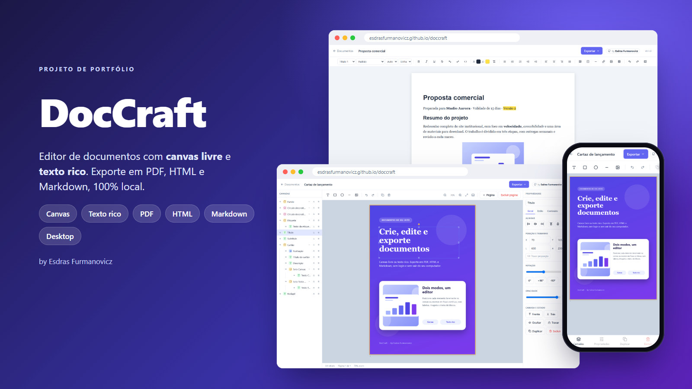

### 👋 Olá! Eu sou o Esdras

Sou **desenvolvedor web com foco em back-end**, atuando profissionalmente com **PHP e Laravel** no desenvolvimento e manutenção de sistemas utilizados em **ambiente real de negócio**.

Trabalho diariamente com regras de negócio, banco de dados, integrações e evolução de sistemas em produção. Tenho interesse especial por **arquitetura back-end**, **automação**, **sistemas embarcados** e projetos que conectam software ao mundo físico.

---

  
  
  
  
  
  
  
  
  
  
  
  
  
  
  
  
  

---

## 🚀 Habilidades Técnicas

- **Back-end:** PHP, Laravel  
- **Front-end:** JavaScript, jQuery, HTML, CSS, Bootstrap  
- **Banco de dados:** MySQL  
- **Infra & DevOps:** Docker, Linux  
- **Versionamento:** Git, GitHub  
- **Outros:** Integração com sistemas embarcados (ESP32)

---

## 📌 Projetos em Destaque

### 📄 DocCraft: editor de documentos (canvas e texto rico)  

🔗 **Demo online:** https://esdrasfurmanovicz.github.io/doccraft/  
🔗 **Repositório:** https://github.com/esdrasfurmanovicz/doccraft  
⬇️ **Baixar o app (Windows, macOS e Linux):** https://github.com/esdrasfurmanovicz/doccraft/releases/latest  

Editor de documentos com **canvas livre** (elementos aninhados, camadas e propriedades completas) e **texto rico** (tabelas, imagens e menu de blocos), com exportação para **PDF, HTML e Markdown**. Roda no navegador ou como **app desktop**, sem login.  
Feito com **React, TypeScript, Node.js, Electron e SQLite**.

---

### 🌱 SIF – Sistema de Irrigação Facilitado  
🔗 https://github.com/sistema-irrigacao-facilitado  

Sistema completo de automação de irrigação utilizando **ESP32**, com backend em **PHP + MySQL** e versão estruturada em **Laravel**.  
O projeto envolveu integração entre hardware e software, coleta de dados, automação e controle remoto.

---

### 📚 Sistema de Biblioteca  
🔗 https://github.com/esdrasfurmanovicz/sistema-biblioteca  

Sistema de gerenciamento de biblioteca desenvolvido com **PHP puro e MySQL**, focado em lógica de negócio, CRUDs completos e organização de dados.

---

### 💈 Landing Page – Barbearia  
🔗 https://github.com/esdrasfurmanovicz/landingpage-barbearia  

Projeto front-end com foco em **design, responsividade e experiência do usuário**, aplicado a um cenário comercial real.

---

## 🌱 Atualmente estudando
- Inglês técnico aplicado à tecnologia  
- Laravel avançado e boas práticas  
- Segurança em aplicações web

---

📫 **Contato:** [LinkedIn](https://www.linkedin.com/in/esdras-furmanovicz)  
💡 **Portfolio:** https://furmanovicz.com.br/
